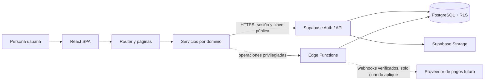
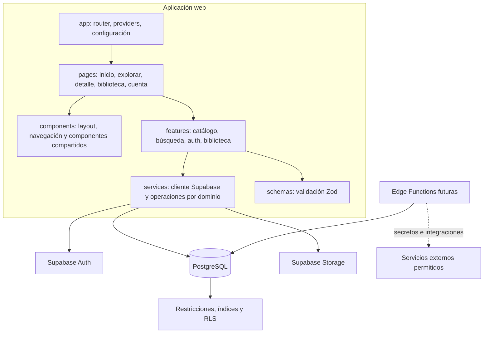
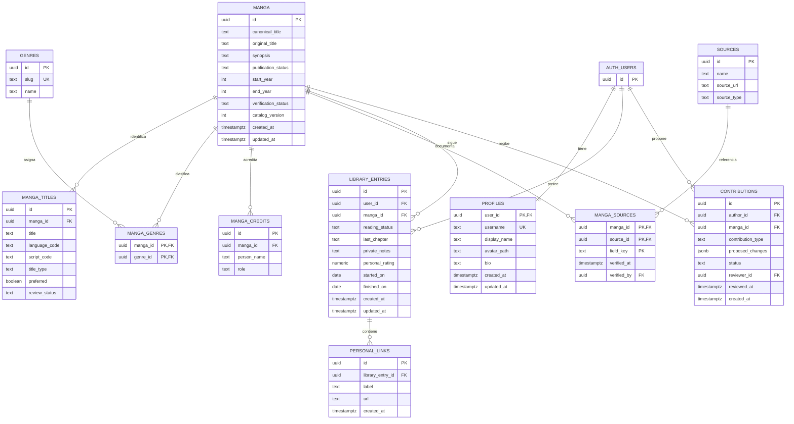

# MangaVerse — arquitectura inicial

## Alcance y principios

Este documento fija una arquitectura para una primera versión de MangaVerse: catálogo bibliográfico con fuentes, búsqueda por títulos y alias, autenticación y biblioteca personal privada con seguimiento de lectura. No se considera implementado ningún servicio ni funcionalidad por el hecho de aparecer aquí.

Principios:

- React y TypeScript en el cliente; PostgreSQL de Supabase como fuente de verdad.
- Un monolito modular inicialmente: una aplicación web, una capa de servicios y capacidades backend de Supabase. Evitar microservicios hasta que exista una necesidad operativa demostrable.
- Catálogo público separado de datos privados del usuario.
- Row Level Security (RLS) como límite de autorización en la base de datos, además de controles de interfaz.
- Cambios editoriales colaborativos mediante propuestas revisables; una propuesta pendiente nunca modifica por sí sola el catálogo aprobado.
- No alojar ni distribuir capítulos, scans, tomos completos ni traducciones no autorizadas.
- No presentar datos desconocidos, de prueba o no verificados como hechos.

## 1. Resumen de arquitectura

### Cliente web

SPA con React, TypeScript, Vite y React Router. Las rutas organizan las páginas, los componentes presentan la interfaz y los módulos de características mantienen su estado y validación de formularios. Tailwind CSS y tokens de diseño definen los temas oscuro y claro. Lucide React se utiliza para iconografía. React Hook Form se incorpora donde un formulario lo justifique.

### Servicios de aplicación

Módulos TypeScript por dominio encapsulan las llamadas a Supabase y transforman resultados para la interfaz. Los componentes no construyen consultas complejas ni implementan reglas de acceso. Zod valida entradas del cliente para dar errores tempranos; la base de datos y las funciones confiables repiten las validaciones que afectan integridad o seguridad.

### Backend y persistencia

Supabase proporciona PostgreSQL, Auth y Storage. Las consultas ordinarias pueden hacerse desde el cliente con la clave pública anon/publishable y políticas RLS restrictivas. Supabase Edge Functions se reservan para operaciones que necesiten secretos, validación de webhooks, límites o una frontera de confianza del servidor. Nunca se incluye una `service_role` key en el navegador.

Las migraciones SQL versionadas definen el esquema, índices, restricciones y políticas RLS. Las operaciones relacionadas que deban ser atómicas se implementan en una función SQL o una operación backend transaccional.

### Flujo de datos



El navegador nunca es autoridad para asignar roles, aprobar contribuciones, confirmar donaciones ni hacer públicos datos privados. Esas operaciones requieren políticas y/o funciones confiables específicas.

## 2. Diagrama de componentes



## 3. Modelo entidad-relación inicial

Las tablas entre corchetes pertenecen a `auth` de Supabase y no se duplican. Los nombres de este diagrama son conceptuales; las migraciones fijarán nombres, tipos, restricciones e índices exactos.



### Reglas de integridad y privacidad

- `library_entries` tendrá una restricción única por `(user_id, manga_id)` y `CHECK` para estado y escala de puntuación. `last_chapter` es seguimiento aportado por el usuario, no un dato editorial.
- Toda lectura y modificación de `library_entries` exige `auth.uid() = user_id`. `personal_links` aplica la misma propiedad mediante una política que comprueba la entrada padre. La tabla y Storage no permitirán acceso público a notas, enlaces ni biblioteca.
- Los perfiles exponen solo columnas públicas seleccionadas; nunca correo, notas, enlaces privados ni datos financieros. Las columnas privadas no deben quedar accesibles mediante una política amplia de `SELECT`.
- El catálogo aprobado puede leerse públicamente; escrituras directas anónimas quedan denegadas. Las propuestas y las operaciones de revisión tienen políticas separadas y roles explícitos.
- Cada alias aprobado apunta a un solo `manga_id`. No se impone unicidad global del texto del alias porque puede ser ambiguo; las colisiones se detectan y resuelven en búsqueda y revisión editorial.
- `MANGA_SOURCES` relaciona fuentes con campos bibliográficos y conserva fecha de verificación. Fechas no confirmadas permanecen nulas y se presentan como desconocidas.
- Contribuciones registran autoría, revisión, estado y cambio propuesto. La aprobación se realiza en una transacción que actualiza catálogo e historial; no se confía en un cambio enviado desde el navegador.
- Roles editoriales/moderadores se almacenan y modifican en una superficie protegida; nunca se asignan con una actualización de perfil del propio cliente.
- Índices iniciales: claves foráneas, estado y actualización del catálogo, alias normalizados y `(user_id, reading_status)` para la biblioteca.

## 4. Estructura de carpetas propuesta

```text
/
├─ public/
├─ docs/
├─ supabase/
│  ├─ config.toml
│  ├─ migrations/
│  ├─ seed.sql                 # solo datos ficticios, identificados como desarrollo
│  └─ functions/               # únicamente funciones confiables necesarias
├─ src/
│  ├─ app/
│  │  ├─ router.tsx
│  │  └─ providers.tsx
│  ├─ components/
│  │  ├─ layout/
│  │  ├─ navigation/
│  │  └─ ui/
│  ├─ features/
│  │  ├─ auth/
│  │  ├─ catalog/
│  │  ├─ search/
│  │  └─ library/
│  ├─ pages/
│  ├─ services/
│  │  ├─ supabase/
│  │  ├─ catalog/
│  │  ├─ search/
│  │  └─ library/
│  ├─ schemas/
│  ├─ styles/
│  ├─ types/
│  └─ test/
├─ e2e/                        # Playwright cuando exista el flujo web
├─ .env.example
├─ .gitignore
├─ package.json
└─ vite.config.ts
```

Cada feature contiene componentes y lógica de interfaz propios; `services/` concentra el acceso a datos. No crear una abstracción de servicio o carpetas vacías antes de que una feature lo requiera.

## 5. Decisiones técnicas y alternativas

| Decisión | Motivo | Alternativa considerada |
|---|---|---|
| SPA con React, TypeScript y Vite | Coincide con las tecnologías solicitadas, permite iteración rápida y tipado integral del cliente. | SSR con Next.js; no es necesario para la primera entrega y agrega decisiones de servidor y despliegue. Reconsiderar si SEO/renderizado lo exige. |
| Supabase Auth + PostgreSQL + Storage | Backend administrado integrado y RLS nativo para proteger la biblioteca. | Backend propio; ofrece más control, pero añade despliegue y mantenimiento sin beneficio claro para el MVP. |
| Monolito modular | Mantiene límites por dominio sin costo operativo distribuido. | Microservicios; pospuestos hasta tener límites de escala/equipo medibles. |
| Acceso desde cliente mediante clave pública y RLS | Adecuado para lecturas públicas y operaciones propias con políticas verificables. | Pasar todo por servidor; mayor control, pero innecesario para operaciones simples y seguras bajo RLS. |
| PostgreSQL Full Text Search + `pg_trgm` | Búsqueda indexable en títulos y alias; soporta texto parcial y tolerancia tipográfica sin servicio adicional. | Motor externo como Meilisearch; reevaluar si volumen, relevancia o latencia lo justifican. |
| Alias normalizados con idioma y tipo | Conserva nombres multilingües vinculados a una ficha canónica. | Una columna por idioma; no escala al número variable de idiomas y variantes. |
| Contribuciones separadas del catálogo aprobado | Evita que ediciones pendientes alteren datos públicos. | Escritura directa con auditoría; riesgo de exposición de vandalismo y reversión compleja. |
| Sin proveedor de pagos en el MVP | El pago necesita verificación de webhooks, idempotencia y análisis de obligaciones/proveedor en Chile. | Mercado Pago o PayPal como decisión futura, tras validar disponibilidad, comisiones y requisitos. |

### Búsqueda

Normalizar mayúsculas, espacios y puntuación en los campos de título. Mantener índices PostgreSQL para búsqueda exacta/prefijos y `pg_trgm` para similitud; combinar resultados de título principal y alias sin duplicar una misma obra. Implementar filtros, ordenación y paginación en la consulta, con límites máximos. Las puntuaciones de búsqueda deben ser deterministas; no tratar similitud como prueba de identidad. La búsqueda por descripción queda fuera del MVP y, si se incorpora, se etiqueta como sugerencia no garantizada.

### Configuración y despliegue

El cliente solo recibe variables públicas como `VITE_SUPABASE_URL` y `VITE_SUPABASE_ANON_KEY` (o la clave publicable equivalente disponible en el proyecto). El archivo `.env.local` se excluye de Git; `.env.example` contiene nombres y marcadores ficticios. Secretos de funciones se configuran en el entorno de Supabase, nunca en Vite. El despliegue se selecciona cuando estén definidos presupuesto, región, dominio y requisitos legales; no se declara proveedor todavía.

## 6. Riesgos principales y controles

| Riesgo | Control previsto |
|---|---|
| Exposición de biblioteca, notas o enlaces | RLS por propietario, políticas negativas para acceso anónimo, pruebas cruzadas entre dos usuarios y revisión de políticas de Storage. |
| Uso incorrecto de clave privilegiada | Prohibir `service_role` en frontend; secretos solo en funciones; revisión de build para evitar variables privadas con prefijo público. |
| Vandalismo o duplicados en el catálogo | Flujo de contribución y aprobación, alias con revisión, historial reversible y confirmación explícita antes de fusionar obras. |
| Datos falsos o desactualizados | Estado de verificación, fuente y fecha asociadas a datos; nulos para desconocido; semillas marcadas como desarrollo. |
| Búsquedas lentas o resultados ambiguos | Índices adecuados, paginación, límites y medición sobre datos realistas; no crear fichas automáticamente por alias. |
| Spam, abuso y moderación insuficiente | Límites por usuario/IP en endpoints apropiados, denuncias, bloqueo y controles de moderación antes de abrir reseñas y comentarios. |
| Enlaces externos inseguros | Validar URL en servidor y cliente, permitir solo esquemas `https`/`http` según política, escapar contenido y avisar que el destino es externo. |
| Uso de imágenes sin licencia | Guardar procedencia/permiso, permitir imágenes solo con derechos adecuados y mostrar una portada tipográfica de respaldo. |
| Errores de pagos o fraude | No incluir pagos en MVP; en etapa futura confirmar solo por webhook verificado, idempotente y registrado. Nunca almacenar tarjetas. |
| Pérdida de datos o costos del proveedor | Definir límites, copias de seguridad y restauración antes de producción; documentar retención y costos según el plan elegido. |
| Requisitos legales y privacidad | Revisar condiciones, privacidad, eliminación/exportación y normativa aplicable antes de producción; no afirmar tratamiento tributario de donaciones sin validación. |

## 7. Plan de implementación por etapas

Las etapas se consideran completas solo después de ejecutar sus pruebas relevantes. Ningún resultado se presume antes de implementarlo y probarlo.

### Etapa 0 — Base del proyecto

- Inicializar Vite/React/TypeScript, formato/lint, pruebas con Vitest y React Testing Library, React Router, Tailwind y cliente Supabase tipado.
- Crear `.env.example`, documentación de instalación y configuración local; preparar Supabase local o proyecto de desarrollo sin secretos en Git.
- Tablas: ninguna funcional de catálogo aún. Primera migración y convenciones de migración/RLS.
- Seguridad: comprobar que faltan variables con error claro; impedir que secretos privados se compilen en el cliente.
- Pruebas: instalación, lint, TypeScript, prueba unitaria mínima y build.
- Pendiente: no hay contenido funcional ni conexión de producción.

### Etapa 1 — Inicio, catálogo, fichas y búsqueda

- Inicio sin estadísticas inventadas, exploración, detalle de manga, títulos alternativos y búsqueda/filtros.
- Tablas: `manga`, `manga_titles`, `genres`, `manga_genres`, `manga_credits`, `sources`, `manga_sources`.
- Seguridad: lectura pública únicamente de contenido publicado/aprobado; escrituras deshabilitadas desde cliente no autorizado.
- Pruebas: búsqueda exacta, alias, normalización, filtros, paginación, resultados vacíos y rutas de detalle; verificar que los alias llegan a la misma ficha.
- Pendiente: datos de catálogo reales solo se incorporan con fuente y permiso apropiados; no incluir portadas protegidas sin autorización.

### Etapa 2 — Registro, autenticación y biblioteca privada

- Registro/inicio/cierre de sesión, biblioteca, estado de lectura, capítulo registrado, notas, puntuación personal y enlaces externos privados; exportación inicial si queda dentro del alcance acordado.
- Tablas: `profiles`, `library_entries`, `personal_links`.
- Seguridad: RLS por `auth.uid()`, validación estricta de URL, protección de rutas solo como UX (no como autorización), políticas de Storage privadas si se añade avatar.
- Pruebas: persistencia tras cerrar sesión, aislamiento de bibliotecas con dos cuentas, acceso anónimo denegado, modificación/eliminación propia y acceso denegado a notas/enlaces de otra cuenta.
- Pendiente: estadísticas compartidas y biblioteca pública desactivadas por defecto.

### Etapa 3 — Wiki colaborativa y auditoría

- Proponer obras/cambios, revisión, aprobación/rechazo, historial y fusión de duplicados con revisión de consecuencias.
- Tablas: `contributions`, `catalog_revisions`, roles editoriales y, cuando corresponda, `merge_proposals`.
- Seguridad: propuestas aisladas del catálogo aprobado; revisión y aplicación transaccional solo por roles autorizados; auditar acciones.
- Pruebas: propuesta pendiente no altera ficha, aprobación sí lo hace y genera revisión, rechazo conserva el catálogo, usuario no puede asignarse rol.
- Pendiente: proceso operativo y política de moderación.

### Etapa 4 — Comunidad y perfiles públicos

- Perfiles públicos configurables, reseñas y puntuaciones, listas compartidas, comentarios y denuncias según prioridad.
- Tablas: `reviews`, `lists`, `list_items`, `follows` (si se adopta), `reports`, `blocks`, `notifications`.
- Seguridad: visibilidad explícita, control anti-spam y moderación; spoilers ocultos inicialmente; una valoración por usuario/obra; donaciones no afectan votos ni ranking.
- Pruebas: privacidad por ajuste, spoilers, unicidad de voto, bloqueo, denuncias y autorización.
- Pendiente: reglas de comunidad y respuesta de moderación.

### Etapa 5 — Logros, cosméticos y donaciones

- Logros gratuitos, galería/equipamiento cosmético y apoyo voluntario; rangos configurables y sin privilegios editoriales.
- Tablas: `achievements`, `user_achievements`, `cosmetics`, `user_cosmetics`, `donations`, `donation_events` y configuración administrativa.
- Seguridad: confirmar operaciones financieras únicamente con webhooks verificados e idempotentes; acceso a datos financieros restringido; archivos con tipo/tamaño permitidos y sin contenido ejecutable.
- Pruebas: eventos repetidos, estado fallido/reembolso/cancelación, desbloqueo solo tras confirmación, límites de archivos y respeto de movimiento reducido.
- Pendiente: escoger proveedor compatible con Chile y revisar requisitos, comisiones, impuestos y política de reembolsos antes de habilitar cobros.

### Etapa transversal — Calidad y operación

- Accesibilidad por teclado/contraste/movimiento reducido, adaptación móvil, observabilidad sin secretos, exportación/eliminación de cuenta, copias de seguridad y procedimiento de recuperación.
- Documentar permisos RLS, diccionario de datos, integraciones, costos, límites, pruebas y despliegue antes de la primera publicación.
- Playwright cubre flujos críticos una vez que existan interfaz y entorno de prueba; Vitest cubre lógica y componentes.

## Criterio para iniciar la implementación

La primera implementación debe comenzar en la Etapa 0 y detenerse para validar antes de avanzar a la Etapa 1. La región/proyecto de Supabase, estrategia de despliegue y fuente de datos del catálogo deben definirse antes de producción; no se requieren credenciales reales para desarrollar la base local.
